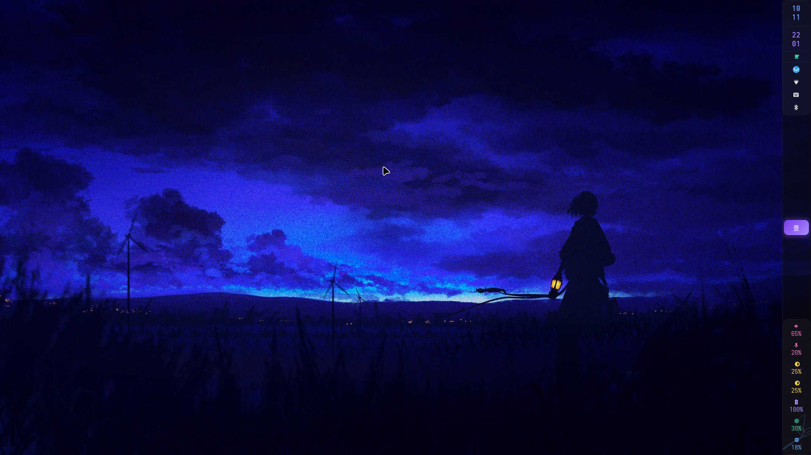

# My Personal Hyprland Config

My Arch Linux + Hyprland dotfiles. The Hyprland config has been migrated from
hyprlang (`.conf`) to **Lua** (`hyprland.lua`), which requires Hyprland 0.55 or
newer.

## Screenshot



## My Setup

- [Acer Nitro 5 AN515-55](https://www.notebookcheck.net/Acer-Nitro-5-AN515-55-Laptop-Review-Price-to-performance-champ-with-an-RTX-3060.540607.0.html)
- [Arch Linux](https://archlinux.org/)
- NVIDIA RTX 3060 (hybrid graphics, see `scripts/gpu_swap.sh`)
- Hyprland (Lua config), Waybar, Walker, Dunst, Kitty

## Repository Layout

| Path | Description |
| --- | --- |
| `hypr/` | Hyprland Lua config (`hyprland.lua` + split modules) |
| `waybar/` | Waybar config and style |
| `dunst/` | Notification daemon |
| `kitty/`, `alacritty/` | Terminal emulators |
| `tofi/`, `rofi/` | Launchers and pickers |
| `wlogout/` | Power menu |
| `mpv/`, `fastfetch/` | Media player and fetch tool |
| `gtk/`, `qt5ct/`, `qt6ct/`, `kvantum/` | GTK/Qt theming |
| `scripts/` | Helper scripts (wallpaper, GPU, volume, media, ...) |
| `install-scripts/` | Installer steps used by `install.sh` |
| `locale/`, `variables/` | Locale and environment variables |
| `res/` | Assets (showcase image, yay package) |

## Installation

> The configs assume this repository lives at `~/dotfiles`. Clone it there
> before running anything.

```bash
git clone https://github.com/HuAi02/dotfiles.git ~/dotfiles
cd ~/dotfiles
./install.sh
```

`install.sh` will:

1. Install `yay` (if missing).
2. Install the packages listed in `install-scripts/install-packages.sh`.
3. Install the SDDM Astronaut theme.
4. Install the Fluent KDE theme.
5. Copy/symlink the configs into `~/.config`.
6. Update `locale.gen` and enable SDDM.

Review the scripts first — they install packages and write to system paths.

## Dependencies

Main packages used by this setup:

```text
# Compositor & Hyprland family
hyprland
hyprpaper
hypridle
hyprlock
hyprsunset
hyprpolkitagent
xdg-desktop-portal-hyprland

# Bars, launchers & menus
waybar
walker (with elephant)
wlogout
tofi
rofi

# Notifications
dunst

# Terminals & shell
kitty
alacritty
zsh
fastfetch

# Audio
pipewire / wireplumber
pavucontrol
easyeffects
playerctl

# Clipboard & screenshots
wl-clipboard
cliphist
grim
slurp

# System & hardware
brightnessctl
ddcutil
auto-cpufreq
nbfc-linux
network-manager-applet
blueman
btop
missioncenter

# Theming
nwg-look
qt5ct
qt6ct
kvantum
fluent-gtk-theme
papirus-icon-theme
bibata-cursor-theme

# Input
fcitx5
fcitx5-chinese-addons

# Apps
nemo
loupe
mpv
vlc
firefox
zen-browser
vesktop
spotify
```

## Keybinds

`SUPER` is the main modifier. The full list lives in `hypr/keybinds.lua`.

| Keybind | Action |
| --- | --- |
| `SUPER + Return` | Open terminal (kitty) |
| `ALT + Space` | App launcher (walker) |
| `SUPER + E` | File manager (nemo) |
| `SUPER + B` | Browser (zen-browser) |
| `SUPER + Q` | Close window |
| `SUPER + F` | Maximize window |
| `SUPER + SHIFT + F` | Fullscreen window |
| `SUPER + V` | Toggle floating |
| `SUPER + P` | Pin window |
| `SUPER + 1..0` | Switch workspace |
| `SUPER + SHIFT + 1..0` | Move window to workspace |
| `SUPER + S` | Toggle scratchpad (`special:magic`) |
| `SUPER + W` | Toggle Waybar |
| `SUPER + H` | Clipboard history (walker + cliphist) |
| `SUPER + L` | Lock (hyprlock) |
| `SUPER + Escape` | Power menu (wlogout) |
| `Print` | Screenshot region to clipboard |
| `CTRL + Print` | Full screenshot to clipboard |
| `ALT + P` / `ALT + SHIFT + P` | Save screenshot region / full screen |
| `CTRL + ALT + W` | Wallpaper picker |
| `SUPER + I` | Edit Hyprland config |

Media, brightness, and microphone keys are bound to `wpctl`, `brightnessctl`,
and `ddcutil`, with desktop notifications for feedback.

## Nitro 5 Keyboard Backlight

Someone made a [module](https://github.com/JafarAkhondali/acer-predator-turbo-and-rgb-keyboard-linux-module)
for this. Install it as a service and it should work fine. The configuration is
autoset on boot in `hypr/autostart.lua`.

## Fan Control

Use [nbfc](https://github.com/nbfc-linux/nbfc-linux) and set the model to
`AN515-51` (it is compatible). This sets automatic fan control:

```bash
nbfc set -a
```

## Hybrid Graphics / NVIDIA

- `hypr/env.lua` contains the NVIDIA environment variables.
- `scripts/gpu_swap.sh` and `scripts/gpu_swap_1.sh` switch between GPU
  configurations.
- `scripts/ollama_gpu_selector.sh` selects the GPU used by Ollama.
- `scripts/osu-discrete-launcher.sh` launches osu! on the discrete GPU.
- `scripts/iommu_script.sh` lists IOMMU groups (useful for VFIO).

## Dark Themes for Apps

```text
nwg-look      (Nordic theme, Adwaita icons, Bibata-Modern-Classic cursor)
qt6ct         (set to kvantum-dark)
qt5ct         (set color scheme to darker)
kvantum       (Qt, KvArcDark theme)
fluent-gtk-theme
Fluent KDE    (link below)
xdg-desktop-portal-gtk or xdg-desktop-portal-hyprland
```

## Chinese Pinyin Input

```text
fcitx5
fcitx5-chinese-addons
```

## Grub Theme

[Mojave Elegant](https://github.com/vinceliuice/Elegant-grub2-themes)

## SDDM Theme

[Astronaut Theme - Hyprland Kath](https://github.com/Keyitdev/sddm-astronaut-theme)

## Fluent KDE Theme

[Fluent KDE](https://github.com/vinceliuice/Fluent-kde.git)

## Credits

Thanks to the Hyprland, Waybar, Walker, and Arch Linux communities for the
software and documentation that made this setup possible.
